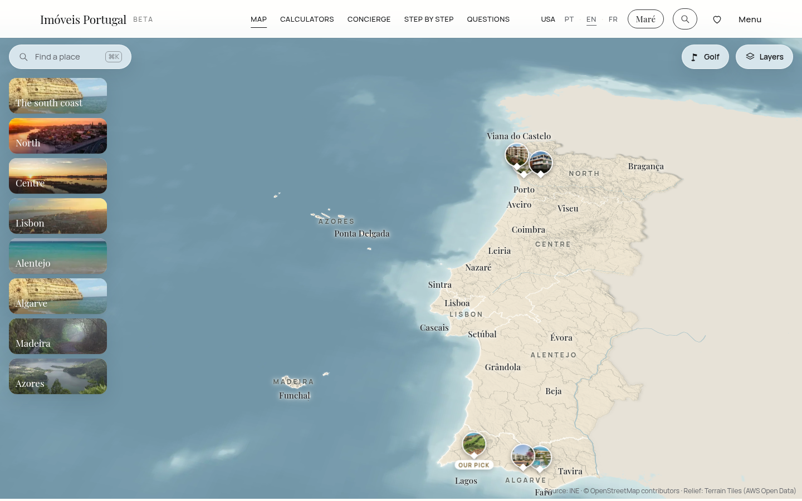
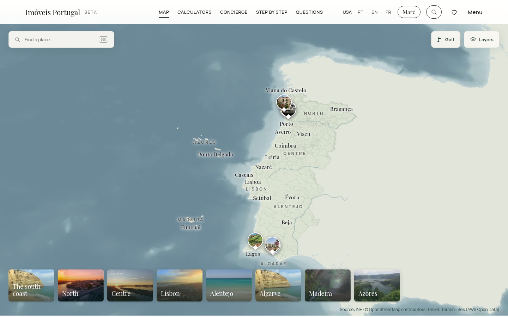
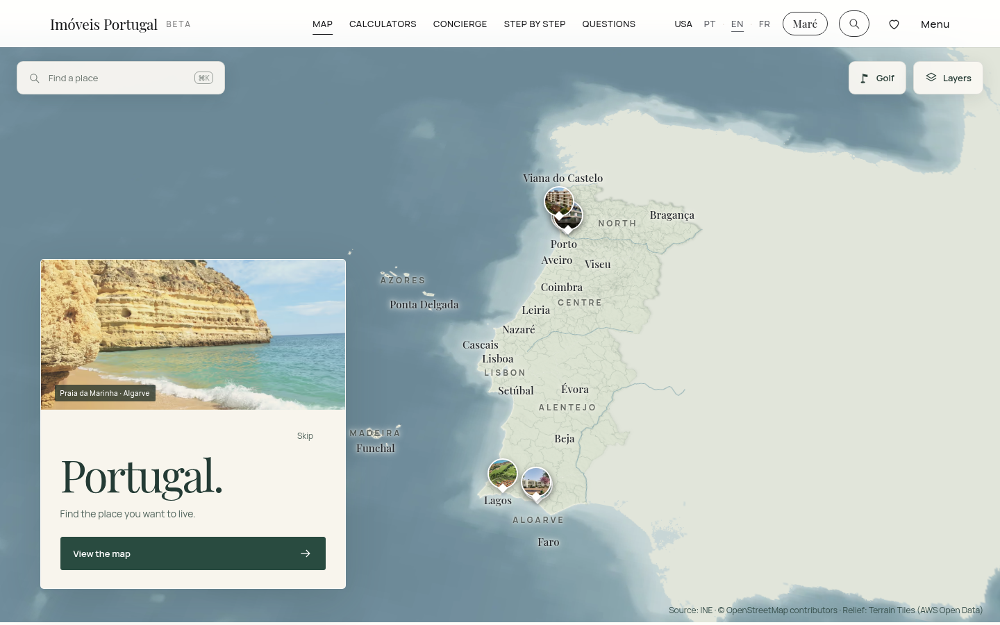
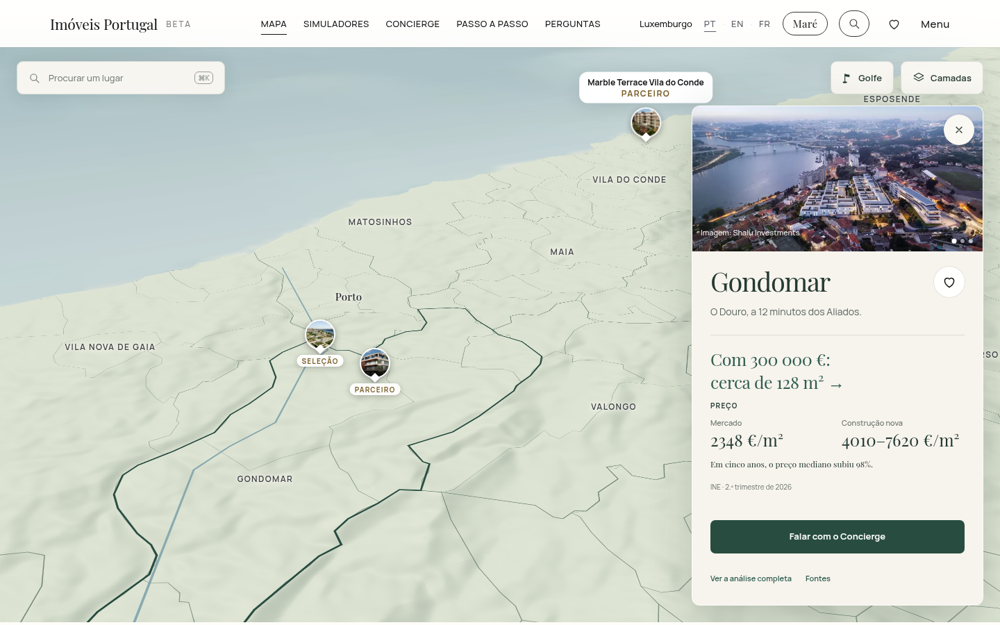
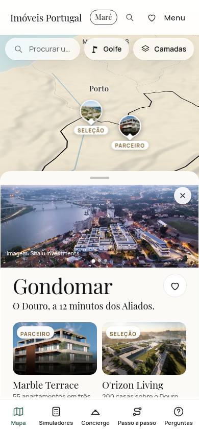
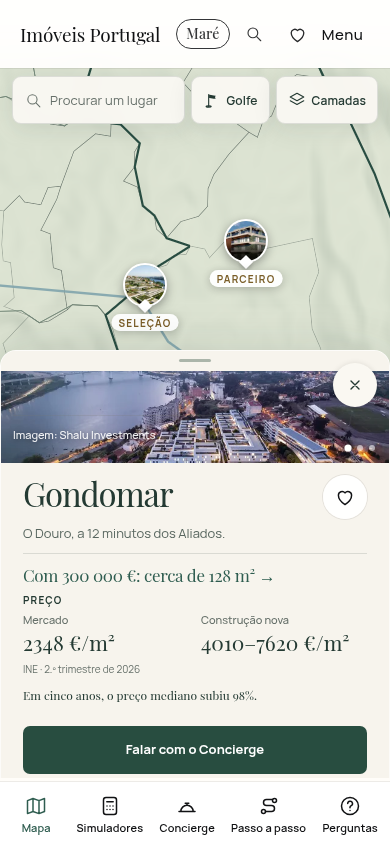
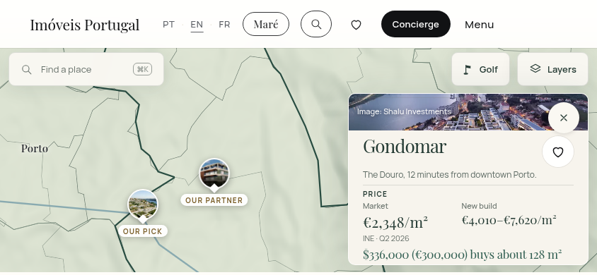

# Issue 4 — Visual review

Original browser screenshots of the running main map, captured 5 November 2026. Before uses the main baseline tree `c7b793930d61eb8b8df924a2c2ca6e59b93c7736`; after uses application revision `0b62517b87995beb6a336245e815c2c0107f763f`. This baseline is not a verified production deployment identity. No generated mockups or image alterations.

## Desktop map · 1440 × 900

Before:

After: natural sage terrain, softer relief and a horizontal photographic region rail.

## Arrival

The optional introduction overlays the actual map stage. This capture uses its normal pointer-hover pause; application timers and imagery are unchanged. Skip, View the map, Escape and direct links preserve immediate access.

## Editorial place card · Luxembourg Portuguese

Desktop brings imagery, local narrative, dated pricing and contextual Concierge into one card.

Mobile before, 390 × 844:

Mobile after, 390 × 844:

## Short landscape · US English · 844 × 390

The compact side card preserves the full budget sentence and reachable controls.

Independent creative review found no visual blockers in the final captures. National geography remains dense in short landscape and northern project pins can overlap. Golf Mode remains Issue #3; these images cover the main map.

The complete local gallery contains 8 baseline and 24 final screenshots across desktop, portrait and landscape. See [release evidence and limits](ISSUE-4-RELEASE.md).
